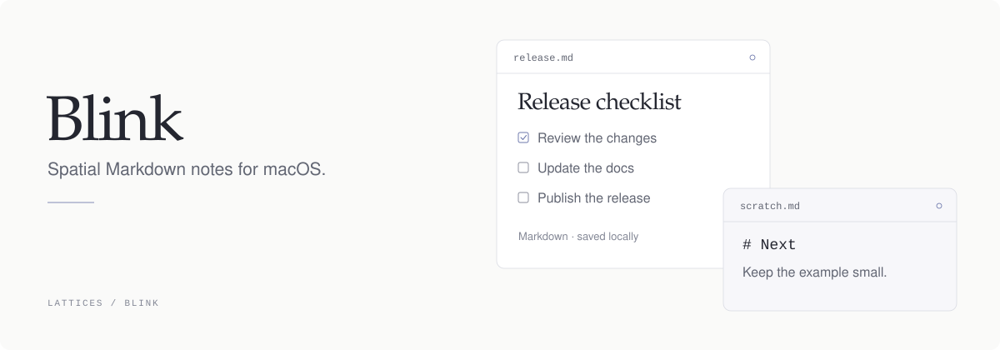

<p><a href="../../README.md">← Lattices</a> &nbsp; / &nbsp; Canvas</p>

<picture>
  <source media="(max-width: 600px) and (prefers-color-scheme: dark)" srcset="assets/readme/hero-mobile-dark.svg">
  <source media="(max-width: 600px) and (prefers-color-scheme: light)" srcset="assets/readme/hero-mobile-light.svg">
  <source media="(prefers-color-scheme: dark)" srcset="assets/readme/hero-dark.svg">
  <source media="(prefers-color-scheme: light)" srcset="assets/readme/hero-light.svg">
  
</picture>

<p align="center">
  <a href="https://lattices.dev/canvas">Product page ↗</a> &nbsp; · &nbsp;
  <a href="#install-and-run">Get started</a> &nbsp; · &nbsp;
  <a href="docs/cli.md">Documentation</a> &nbsp; · &nbsp;
  <a href="../../skills/blink/SKILL.md">Agent skill</a>
</p>

Canvas is a native macOS app for floating Markdown notes. Each note remembers its position and size. The app and CLI read and edit the same local files.

<table><tr>
<td width="33%" valign="top"><strong>Quick capture</strong><br>Open a note from the menu bar, command palette, or a global hotkey.</td>
<td width="33%" valign="top"><strong>Floating panels</strong><br>Arrange floating panels beside your work. Return to the same position and size.</td>
<td width="33%" valign="top"><strong>Local Markdown</strong><br>You and your agents read and edit the same local Markdown files.</td>
</tr></table>

## Install and run

Canvas is the new product name. The 2.3.0 release contract uses
`Canvas.app` and `canvas`; the package remains `@arach/blink`. These install
commands target 2.3.0. Older installations use `blink` and `Blink.app`.

The packaged app and CLI require macOS 14+ on Apple Silicon. Install the package
with Bun; its command launchers require Node.js 18+.

```sh
bun add --global @arach/blink@2.3.0
canvas app install
canvas app open
```

The package includes the native `canvas` CLI and the compatible `blink` name.
`canvas app install` validates the selected release and installs its app in
`/Applications`; `canvas app open` launches it. To update, run `canvas app update`.
The canonical 2.3.0 download contains `Canvas.app`. The legacy channel contains
a real `Blink.app` with the same signed contents and visible Canvas name, so
older `blink app update` commands keep working. See the
[release contract](docs/release.md) for the channel and filename mapping.
You can also get the app from the [download page](https://lattices.dev/canvas/download).

Canvas runs from the menu bar without a Dock icon. Press Hyper+N to create a note;
Hyper means Control+Option+Shift+Command. The default Hyper+B shortcut shows or
hides the note panels. Hotkeys are configurable in [config.json](docs/config.md).

## Notes and panels

The CLI can create and edit notes while the app is closed. Live panel commands
need Canvas running with the same data directory. These examples use the
current source command `canvas`; `blink` accepts the same note verbs.

```sh
canvas present readme-review "# README review" --slot 6 --writer agent
canvas desk open readme-review
canvas type readme-review "Check the build commands." --writer agent
canvas cat readme-review
canvas ls --json
```

`present` creates or updates a note's content and presentation. `type` appends text
with a typed reveal in an open panel; `write` replaces the body without that
animation. `desk open` opens or focuses the note's single panel. See the
[CLI reference](docs/cli.md) for search, placement, JSON output, and other commands.

Notes live in `~/Library/Application Support/Blink/Notes/`, one Markdown file per
note with YAML frontmatter. Writes are atomic, and Canvas preserves frontmatter
keys it does not own. The app watches this directory and reconciles external
changes through `NoteStore`.

The same application-support directory holds `config.json` for behavior and
appearance, and `edits.sqlite` for the append-only edit ledger. Markdown remains
the source of truth for note contents. Configuration changes apply while the app
is running. Per-device panel frames and the open-panel set live in `UserDefaults`.

In current source builds, the first nonempty `CANVAS_HOME`, then `BLINK_HOME`,
overrides the file-backed data directory for tests or agent work. Empty values
are ignored. Either override disables mobile sharing; neither redirects
`UserDefaults`. Older releases recognize `BLINK_HOME` only.

The rename preserves the existing notes, attachments, configuration, ledger,
panel settings, and Keychain-backed paired devices. The bundle IDs, `blink.sock`, `blink.*`
frontmatter, attachment scheme, and Keychain identifiers stay unchanged. No
manual data move is needed.

Mobile access starts off on a new install. Existing explicit settings are
respected; an older config without the setting retains access when valid
Keychain approvals exist. See [mobile sync](docs/ios-sync.md).

Use [workspaces](docs/workspaces.md) to group notes and give them shared visual
settings. Named desk arrangements save and restore the open panels:

```sh
canvas desk save review
canvas desk ls --json
canvas desk restore review
```

## Relationship to Lattices

Lattices manages the desktop workspace; Canvas owns its note panels and data.
Canvas is a separate app with its own signing, lifecycle, CLI, and store. It shares
the monorepo, website, and [agent skill catalog](../../skills/blink/SKILL.md)
with Lattices core.

Use `canvas` for note operations (`blink` remains compatible). The current
source family entry point, `lats canvas`, forwards to this product; `lats blink`
is an alias. Canvas owns its private Unix socket at
`~/Library/Application Support/Blink/blink.sock`, separate from the
[Lattices daemon](../../docs/api.md). The gateway keeps the persisted product
identity `blink` when authorizing remote requests. The product's broader agent
API and MCP design documents remain proposals.

## Architecture

Native Swift/AppKit panels host the CodeMirror 6 editor in `WKWebView`.
`NoteStore` owns note mutations; `PanelManager` owns panel identity, geometry,
and save flushing. The CLI uses the same BlinkCore file storage as the app.

```text
Sources/BlinkApp/    Menu bar, panels, palette, editor bridge, local socket
Sources/BlinkCore/   Notes, frontmatter, storage, workspaces, desk layouts
Sources/BlinkCLI/    Native notes and panel commands
Sources/BlinkPeer/   Encrypted local-network pairing and snapshot transport
web/editor/         CodeMirror editor and its bundle build
apps/ios/           Read-only iPhone and iPad companion
Tests/              Core and peer protocol tests
packages/npm/       Published CLI wrapper and app installer
scripts/            Local app bundling and launch
tools/release/      CLI and DMG packaging, signing, and release tooling
docs/               CLI, configuration, workspaces, sync, and release docs
```

<details>
<summary><strong>Build from source</strong></summary>

Use macOS 14+, a Swift 6 toolchain, Bun, and Node.js 18+. The editor build script
runs with Node. SwiftPM resolves a pinned revision of the Hudson repository
over SSH, so the build needs Git access to that repository.

From the Lattices repository root:

```sh
cd products/blink
(cd web/editor && bun install && bun run build)
./scripts/run-app.sh --debug --restart
```

The launch script builds `CanvasApp`, bundles the editor into `dist/Canvas.app`, and
launches that bundle. `--restart` stops an existing process from the same bundle
path. Build the editor first: the native script does not build it for you.

To build and inspect the notes CLI from the product directory:

```sh
swift build --product canvas
.build/debug/canvas ls --json
```

Use `.build/debug/canvas` in place of `canvas` in the note examples above.
`swift build --product blink` still builds the compatible CLI alias; `BlinkApp`
is also retained as a SwiftPM app product alias. The `canvas app` / `blink app`
installer belongs to the packaged command wrapper, not the Swift executable.
The 2.3.0 wrapper provides both names; older wrappers use `blink`.

The repository root also provides build and test scripts:

```sh
bun run canvas:build
bun run canvas:check
```

These run the product's Swift build and tests; `blink:build` and `blink:check`
remain aliases. For local Hudson development,
set `BLINK_HUDSON_SOURCE=path` and optionally `BLINK_HUDSON_PATH`; its default
is `../../../hudson`, relative to this product. See [Package.swift](Package.swift)
for dependency selection and [release documentation](docs/release.md) for packaging.

</details>

## Documentation

- [CLI](docs/cli.md): note operations, live panels, and structured output.
- [Configuration](docs/config.md): hotkeys, behavior, panel appearance, and editor theme.
- [Workspaces](docs/workspaces.md): note groups and shared visual settings.
- [iOS companion](docs/ios-sync.md): pairing, offline snapshots, and build instructions.
- [Releases](docs/release.md): build artifacts, signing, and distribution.
- [Product page](https://lattices.dev/canvas): overview and downloads.

---

<p align="center">
<a href="../../README.md">Lattices</a> · <a href="../action/README.md">Action</a> · <a href="../blink/README.md">Canvas</a> · <a href="../voice/README.md">Speech / Voice</a></p>
